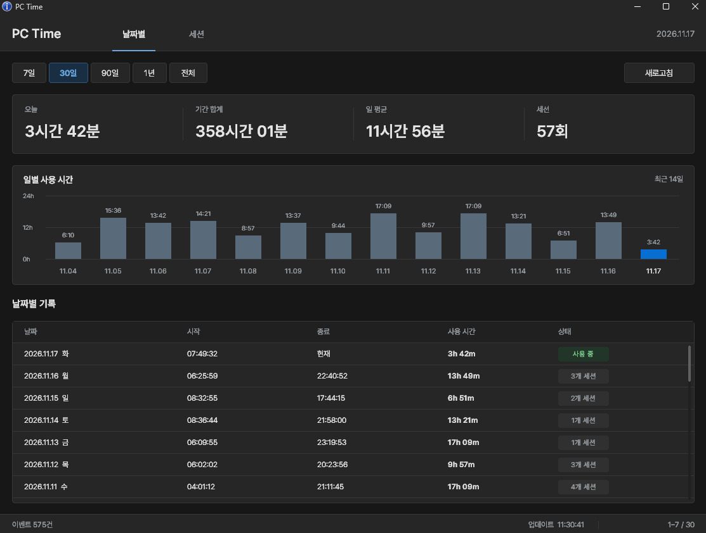

# PC Time

Windows의 기존 부팅·종료 로그에서 날짜별 PC 사용 시간을 확인하는 Rust 프로그램입니다.

**[최신 버전 다운로드](https://github.com/comm3451/pctime/releases/latest/download/PC-Time.exe)** · [릴리스 목록](https://github.com/comm3451/pctime/releases)



## 실행

Windows 10 / 11 **x64**에서 `PC-Time.exe`를 실행하세요. 설치나 별도 런타임이 필요하지 않습니다.

- 오늘 사용 시간, 기간 합계, 일 평균, 세션 수
- 7일 / 30일 / 90일 / 1년 / 전체 기간 조회
- 일별 그래프와 부팅·종료 세션 목록
- 날짜나 그래프를 누르면 해당 날짜의 세션 표시
- 절전 시간 자동 제외
- 다크 테마와 내장 Pretendard 폰트

실행 중인 창에서 1분마다 갱신하며, `F5` 또는 새로고침 버튼으로 즉시 갱신할 수 있습니다. 목록은 마우스 휠, 방향키, Page Up / Down으로 이동합니다.

System 로그에 접근할 수 없다는 오류가 나오면 관리자 권한으로 실행하세요.

## 데이터

Windows의 기존 System 이벤트 로그만 읽습니다. 별도 사용 기록 파일이나 자동 시작 항목을 만들지 않으며, 실행 중 네트워크 연결을 사용하지 않습니다.

부팅·종료, 빠른 시작, 절전·복귀 이벤트를 조합해 시간을 계산합니다. 자정을 넘는 세션은 날짜별로 나누고, 비정상 종료 시각은 추정으로 표시합니다. 종료 기록이 없는 과거 구간은 합계에서 제외합니다. 삭제되었거나 보존 기간이 지난 로그는 복원할 수 없습니다.

## 빌드

Windows x64, Rust stable MSVC 툴체인, Visual Studio C++ 빌드 도구와 Windows SDK가 필요합니다.

```powershell
git clone https://github.com/comm3451/pctime.git
cd pctime
.\build.ps1 -Test
```

결과: `dist/PC-Time.exe`

외부 Cargo 의존성이 없으며, 폰트와 라이선스 고지는 EXE 안에 포함됩니다. C 런타임도 정적으로 링크합니다.

```powershell
cargo test --locked --offline
cargo build --release --locked --offline
```

## 릴리스

`.github/release-version`의 버전을 변경해 `main`에 올리면 GitHub Actions가 테스트와 Windows 빌드 후 릴리스를 게시합니다. Actions의 **Release** 워크플로를 수동 실행할 수도 있습니다. 버전은 `Cargo.toml`과 일치해야 하며 기존 릴리스를 덮어쓰지 않습니다.

릴리스에는 단일 EXE와 `SHA256SUMS.txt`를 제공합니다.

## 라이선스

앱 소스는 [MIT License](LICENSE)로 제공합니다.

[Pretendard](https://github.com/orioncactus/pretendard) Regular / SemiBold는 [SIL Open Font License 1.1](assets/fonts/LICENSE.txt)을 따릅니다.

`PC-Time.exe --licenses`로 포함된 라이선스 전문을 출력할 수 있습니다.
